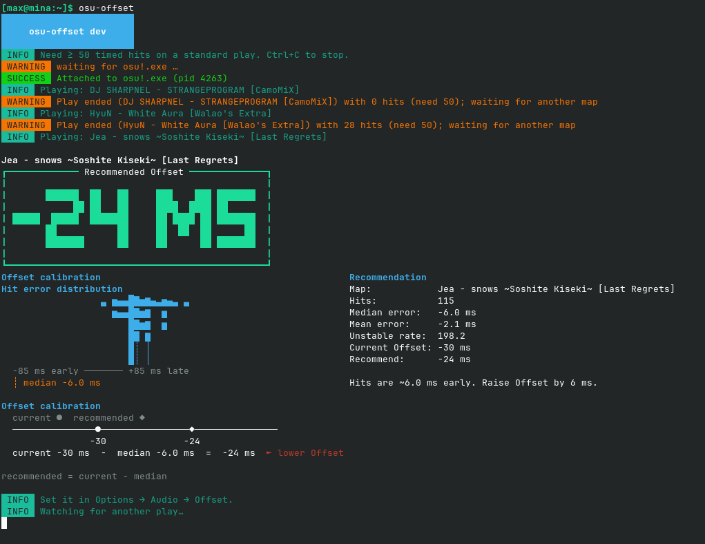

<div align="center">

# nix-osu-stable-cheat

> Variante local: usa o `osu!.exe` empacotado em `pkgs/osu-wine-cheat/osu!.exe` (nenhum download do osu!).
> Comando: `osu-wine-cheat` (ex.: `osu-wine-cheat --apply-settings`). Estado em `~/.local/share/nix-osu-stable-cheat`.
> Uso local: `git init && git add -A && nix run .#osu-wine-cheat` (flakes só enxergam arquivos rastreados pelo git).

**Play osu! stable on NixOS** — native integration using wine-osu + Steam Runtime (the [osu-winello](https://github.com/NelloKudo/osu-winello) stack), a prebuilt prefix, and an optional TUI offset tool (works similarly to osu!lazer's offset recommendation system).
This is for nixos, so naturally yes, beatmaps (downloaded from mirror), skins, settings, are all declarable.

[](https://nixos.org)
[](https://nixos.wiki/wiki/Flakes)

</div>

## ⚡ Quick Start

**Just want to try it?**
```bash
nix run .#osu-wine-cheat-cheat
```

> **Requirements:** `x86_64-linux`, flakes enabled, ~500MB disk space on first launch.

---

## 📦 Install with Home Manager

### 1. Add to flake inputs

```nix
{
  inputs = {
    nixpkgs.url = "nixpkgs/nixos-unstable";
    home-manager.url = "github:nix-community/home-manager";
    home-manager.inputs.nixpkgs.follows = "nixpkgs";
    
    nix-osu-stable-cheat.url = "github:shntsk/nix-osu-stable-cheat";
    nix-osu-stable-cheat.inputs.nixpkgs.follows = "nixpkgs";
  };

  outputs = { self, nixpkgs, home-manager, nix-osu-stable-cheat, ... }:
    {
      nixosConfigurations.YOUR_CONFIGURATION = nixpkgs.lib.nixosSystem {
        system = "x86_64-linux";
        modules = [
          ./configuration.nix
          home-manager.nixosModules.home-manager
          {
            home-manager = {
              useGlobalPkgs = true;
              useUserPackages = true;
              extraSpecialArgs = { inherit nix-osu-stable-cheat; };
              users.YOUR_USERNAME = import ./home.nix;
            };
          }
        ];
      };
    };
}
```

### 2. Enable in `home.nix`

```nix
{ nix-osu-stable-cheat, ... }:
{
  imports = [ nix-osu-stable-cheat.homeModules.osu-stable-cheat ];

  programs.osu-stable-cheat = {
    enable = true;
    offsetCalculator.enable = true;
    # OTD absolute mode on Wayland is auto-detected; override if needed:
    # environment.WINE_ENABLE_ABS_TABLET_HACK = "2";
    # location = "${config.xdg.dataHome}/nix-osu-stable-cheat";
  };
}
```

### 3. Build & launch

```bash
nix flake update nix-osu-stable-cheat
sudo nixos-rebuild switch --flake .#YOUR_CONFIGURATION
osu-wine-cheat
```

✅ First run downloads the Steam Runtime, seeds the prefix, and installs osu!  
✅ Subsequent launches are instant  
✅ Desktop entry + file associations included

---

## 🎵 Audio Offset

Wine adds some audio latency versus native Windows. osu-winello recommends **−40/−35 ms** universal Offset (or **−25 ms** if you use Audio Compatibility mode). Your mileage varies — keep an eye on the hit meter.

Enable [osu-offset](https://github.com/gaavin/offset-calc-osu-stable) to measure from live hit error:

```nix
programs.osu-stable-cheat = {
  enable = true;
  offsetCalculator.enable = true;
};
```

Run `osu-offset` next to `osu-wine-cheat`. After a map with ≥ 50 timed hits it prints a recommended Offset (`current − median`). Leave it running; it updates after every usable play.



---

## Display latency (Wayland)

osu!stable presents with `wglSwapBuffers` (OpenGL), not a DXGI/Vulkan swapchain. The launcher prefers **native winewayland** whenever `WAYLAND_DISPLAY` is set:

- Writes `HKCU\Software\Wine\Drivers` `Graphics=wayland,x11` (keeps host `DISPLAY` so pressure-vessel is happy).
- NVIDIA `__GL_MaxFramesAllowed=1` and Mesa `mesa_glthread=false` to keep one frame in flight.

Escape hatch:

```nix
programs.osu-stable-cheat.environment.WINE_OSU_USE_X11 = "1";          # X11 / XWayland
```

Visual latency dropping a compositor frame can change how hits *feel*. Re-run `osu-offset` after switching present paths.

---

## 🎛️ Declarative in-game settings, beatmaps, and skins.

Manage osu!stable options from Home Manager. Keys match [`osu!.*.cfg`](https://osu.ppy.sh/wiki/en/Client/Program_files/User_configuration_file):

```nix
programs.osu-stable-cheat = {
    enable = true;
    offsetCalculator.enable = true;

    settings = {
      ChatChannels = "#osu #userlog";
      VolumeEffect = 60;
      CursorSize = 1.1;
      DimLevel = 100;
      EditorHitAnimations = 1;
      FrameSync = "Unlimited";
      IHateHavingFun = 1;
      IgnoreBeatmapSkins = 1;
      Offset = -40;
      PopupDuringGameplay = 0;
      Skin = "Shigetora's Skin";
      VolumeUniversal = 50;
      keyOsuLeft = "E";
      keyOsuRight = "R";
      keyOsuSmoke = "T";
    };

    beatmaps = [
      376552
      377930
      636839
      1898232
      2142914
      2198943
      2258243
      2281545
      2298941
      2432962
      2512831
      2527269
      2533966
    ];

    skins = [ "https://circle-people.com/wp-content/Skins/Cookiezi/Cookiezi%2004.osk" ];
  };
```

Settings are merged on `home-manager switch` / activation and again every launch. Unmanaged keys — including a locally saved **Password** hash — are preserved. The module **refuses** declarative `Password`. Only list overrides in your flake; `--export-settings` skips factory defaults and ephemeral session keys.

```bash
osu-wine-cheat --apply-settings    # merge now
osu-wine-cheat --export-settings   # print only keys that differ from factory defaults
```

---

Beatmaps are downloaded with packaged [aria2](https://aria2.github.io/). At sync time the script probes [catboy.best](https://catboy.best), [osu.direct](https://osu.direct), [nerinyan](https://nerinyan.moe), [beatconnect](https://beatconnect.io), and [sayobot](https://osu.sayobot.cn), then downloads every missing set in parallel (`-x5`) spread across reachable mirrors. Failures retry on the next mirror. Prefer no-video endpoints when a mirror has one. Sets extract under `Songs/` as `{id} Artist - Title`. Skins extract under `Skins/` (name from `skin.ini` when present). Failed downloads are skipped with a warning so activation still succeeds. A wiped `Songs/` directory re-fetches every listed set during `home-manager switch`.

Already have maps from in-game downloads? `--export-beatmaps` prints a `beatmaps = [ ... ];` snippet you can paste into the module — same idea as `--export-settings` for cfg overrides.

```bash
osu-wine-cheat --sync-content      # fetch anything still missing
osu-wine-cheat --export-beatmaps   # print installed set IDs as a nix beatmaps list
```

---

## Optional: Low-Latency PipeWire

Default PipeWire works, but a locked quantum reduces buffer delay to ~2.7ms:

```nix
# In configuration.nix (NixOS, not Home Manager):
services.pipewire = {
  enable = true;
  pulse.enable = true;
  extraConfig.pipewire."92-low-latency" = {
    "context.properties" = {
      "default.clock.rate" = 48000;
      "default.clock.quantum" = 128;
      "default.clock.min-quantum" = 128;
      "default.clock.max-quantum" = 128;
    };
  };
  extraConfig.pipewire-pulse."92-low-latency" = {
    "pulse.properties" = {
      "pulse.min.req" = "128/48000";
      "pulse.default.req" = "128/48000";
      "pulse.max.req" = "128/48000";
      "pulse.min.quantum" = "128/48000";
      "pulse.max.quantum" = "128/48000";
    };
    "stream.properties" = {
      "node.latency" = "128/48000";
      "resample.quality" = 1;
    };
  };
};

security.rtkit.enable = true;
```

After rebuild, restart PipeWire and **re-check your audio offset** — lower latency changes how it feels.

**Hearing crackling?** Try `quantum = 256` instead.

---

## 💬 Discord Rich Presence

osu! can't reach Discord from Wine directly. Choose one:

**Option A: Vesktop (recommended)**
```nix
programs.vesktop = {
  enable = true;
  settings.arRPC = true;
};
```

**Option B: Keep defaults** (`arrpc = true` by default)  
Start Discord first, then launch osu!. If broken after update: `osu-wine-cheat --fixrpc`

---

## 📋 Commands

| Command | Purpose |
|---------|---------|
| <span>osu-wine-cheat</span> | Launch |
| <span>osu-wine-cheat --help</span> | List all commands |
| <span>osu-wine-cheat --info</span> | Show config / paths |
| <span>osu-wine-cheat --apply-settings</span> | Merge declarative in-game settings into `osu!.*.cfg` |
| <span>osu-wine-cheat --export-settings</span> | Print keys that differ from factory defaults as nix attr lines |
| <span>osu-wine-cheat --export-beatmaps</span> | Print installed beatmap set IDs as a nix `beatmaps` list |
| <span>osu-wine-cheat --sync-content</span> | Download missing declarative beatmaps/skins |
| <span>osu-wine-cheat --kill</span> | Force quit |
| <span>osu-wine-cheat --fixrpc</span> | Reinstall Discord bridge |
| <span>osu-wine-cheat --winecfg</span> | Wine settings |
| <span>osu-wine-cheat --winetricks …</span> | winetricks in prefix |

Opening `.osz` / `.osk` / `.osr` files or `osu://` links **reuses the running instance**.

---

## 📁 File Structure

```
~/.local/share/nix-osu-stable-cheat/
  yawl/          Steam Runtime
  wineprefix/    Wine prefix
  osu/           Game files, songs, skins
  logs/          Debug logs
```

Nix pins wine-osu-cheat & yawl versions (edit [`versions.nix`](./versions.nix)); osu! itself auto-updates. Optional Wine-side patches for a custom rebuild live in [`wine-osu-patches-cheat/`](./wine-osu-patches-cheat/).

---

## 🔧 Troubleshooting

| Issue | Solution |
|-------|----------|
| Hits feel late | Enable `offsetCalculator`, run `osu-offset` while you play, and set the printed Offset |
| Wayland present broken | `programs.osu-stable-cheat.environment.WINE_OSU_USE_X11 = "1";` then relaunch |
| Audio crackling | Raise PipeWire quantum to `256` |
| First launch hangs | Normal (downloading Steam Runtime); ensure network access |
| Won't start after update | `osu-wine-cheat --kill` then relaunch |
| No Discord presence | Start Discord first, then `osu-wine-cheat --fixrpc` |
| "Runtime Platform missing" | `osu-wine-cheat --kill && rm ~/.local/share/nix-osu-stable-cheat/yawl/.runtime-ready` |
| Multiple windows opening | Update flake; file handlers should enter running instance |
| Start fresh | Remove `~/.local/share/nix-osu-stable-cheat/` (everything re-downloads) |

---

## 🎮 Advanced

### Package only (skip Home Manager)
```nix
home.packages = [
  inputs.nix-osu-stable-cheat.packages.${pkgs.stdenv.hostPlatform.system}.osu-wine-cheat
];
```

### Custom overrides
```nix
inputs.nix-osu-stable-cheat.packages.${pkgs.stdenv.hostPlatform.system}.osu-wine-cheat.override {
  location = "$HOME/Games/osu";
  useGameMode = false;
  environment.mesa_glthread = "true";
  preLaunchArgs = "mangohud";
}
```

### Available flake packages
- `osu-wine-cheat` — Launcher, desktop entry, MIME handlers (default)
- `osu-offset` — Watch osu!.exe and recommend universal Offset from live hit error
- `wine-osu-cheat` — Wine binaries
- `yawl` — Steam Runtime launcher
- `osu-wineprefix-cheat` — Prefix seed
- `osu-mime-cheat` — File associations
- `rpc-bridge-cheat` — Discord bridge

```bash
nix build github:shntsk/nix-osu-stable-cheat#osu-wine-cheat
```

---

## 🙏 Credits

Built on [osu-winello](https://github.com/NelloKudo/osu-winello) stack:

- [NelloKudo/WineBuilder](https://github.com/NelloKudo/WineBuilder) — wine-osu
- [whrvt/wine-osu-patches](https://github.com/whrvt/wine-osu-patches) — osu! Wine patches
- [whrvt/yawl](https://github.com/whrvt/yawl) — Steam Runtime launcher
- [EnderIce2/rpc-bridge](https://github.com/EnderIce2/rpc-bridge) — Discord RPC
- [OpenAsar/arrpc](https://github.com/OpenAsar/arrpc) — Discord IPC
- [openglfreak/osu-handler-wine](https://github.com/openglfreak/osu-handler-wine) — File handoff
- [fufexan/nix-gaming](https://github.com/fufexan/nix-gaming) — Pattern inspiration
- God
